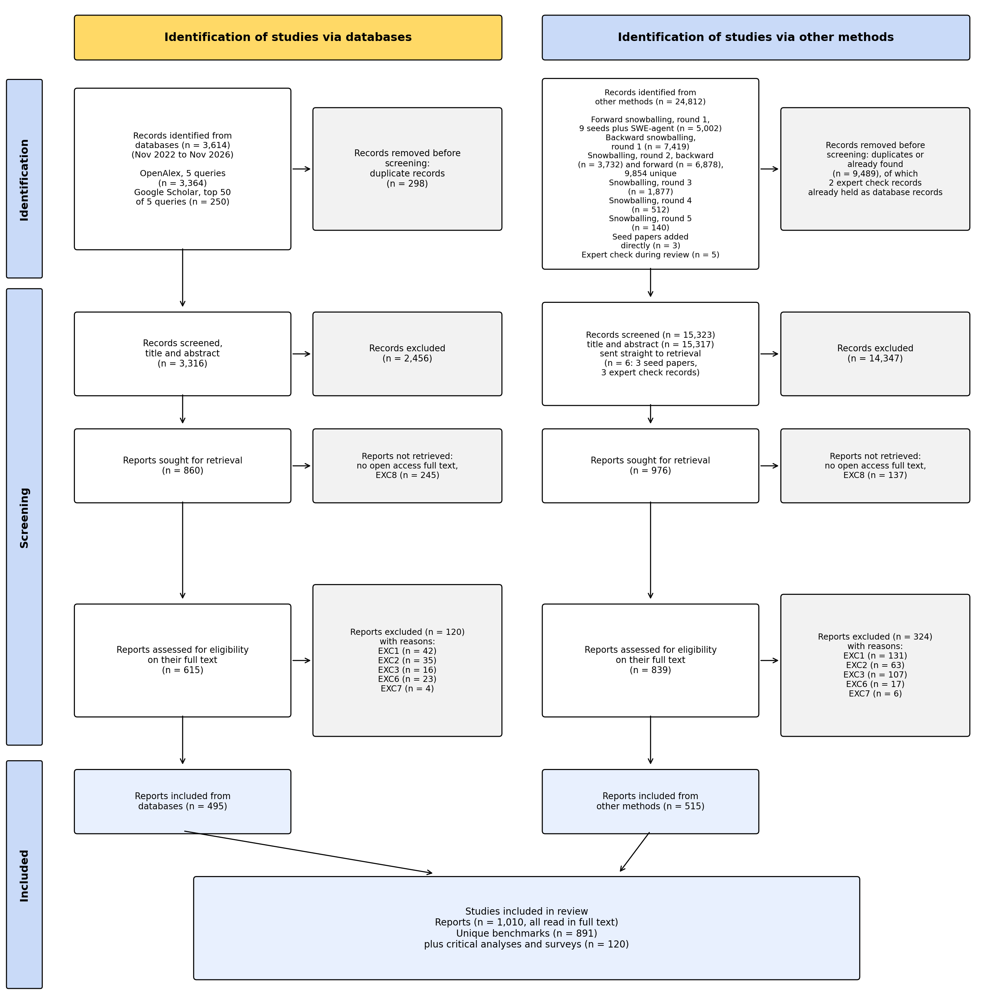
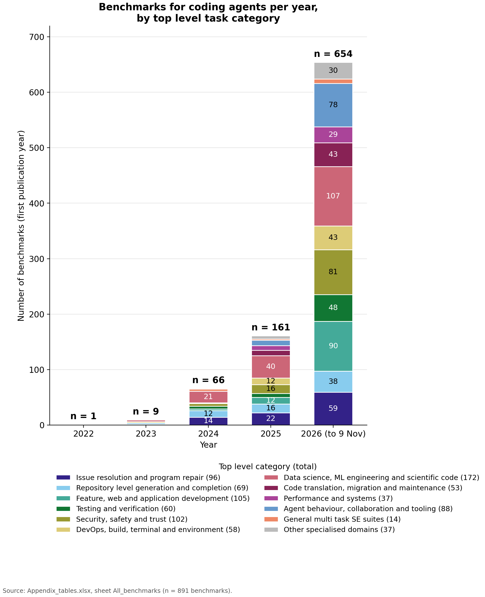
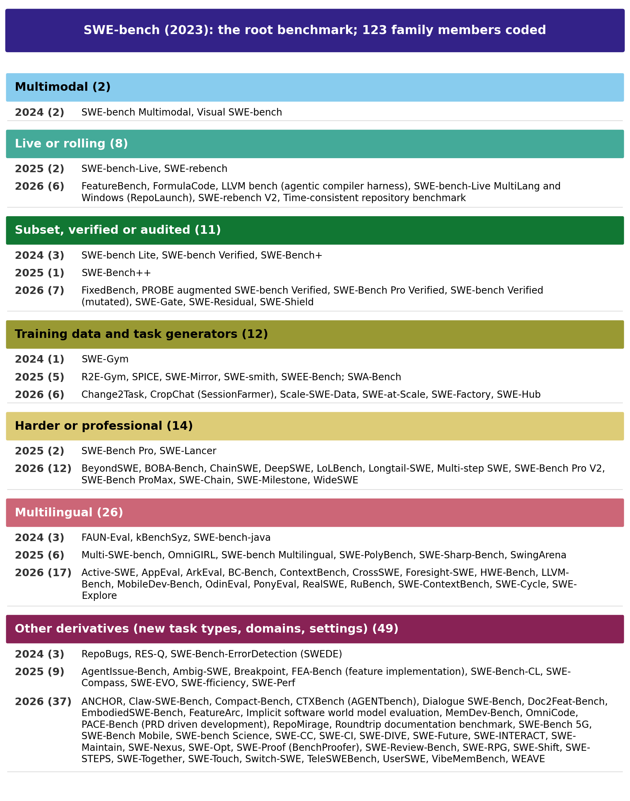
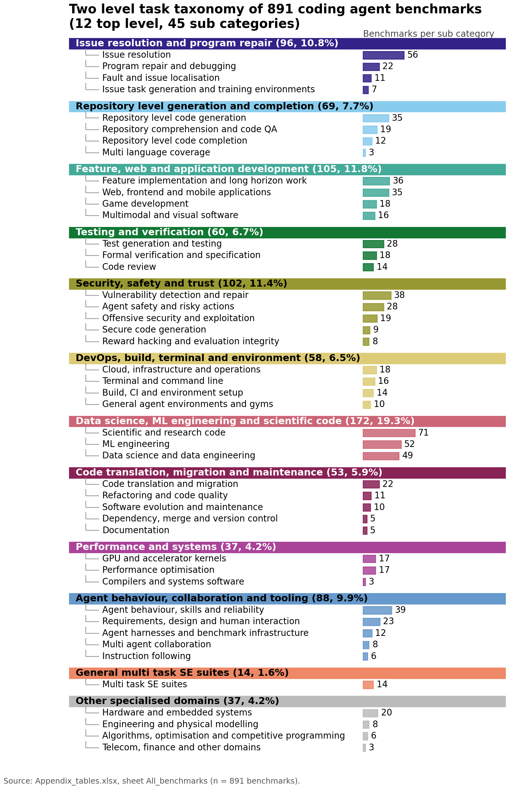
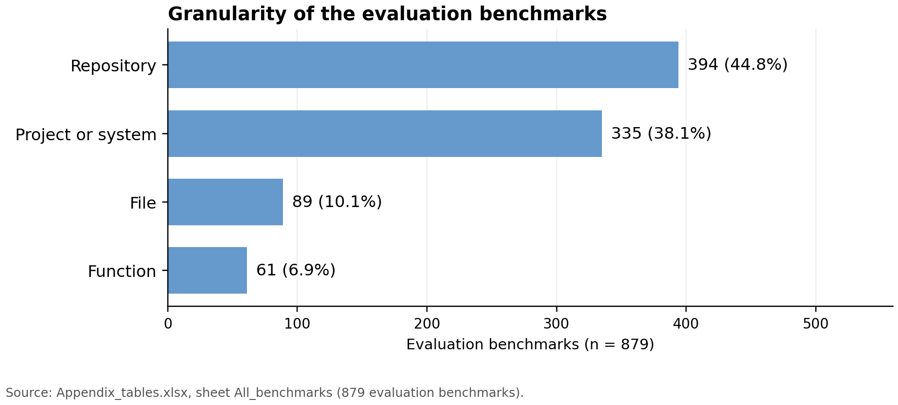
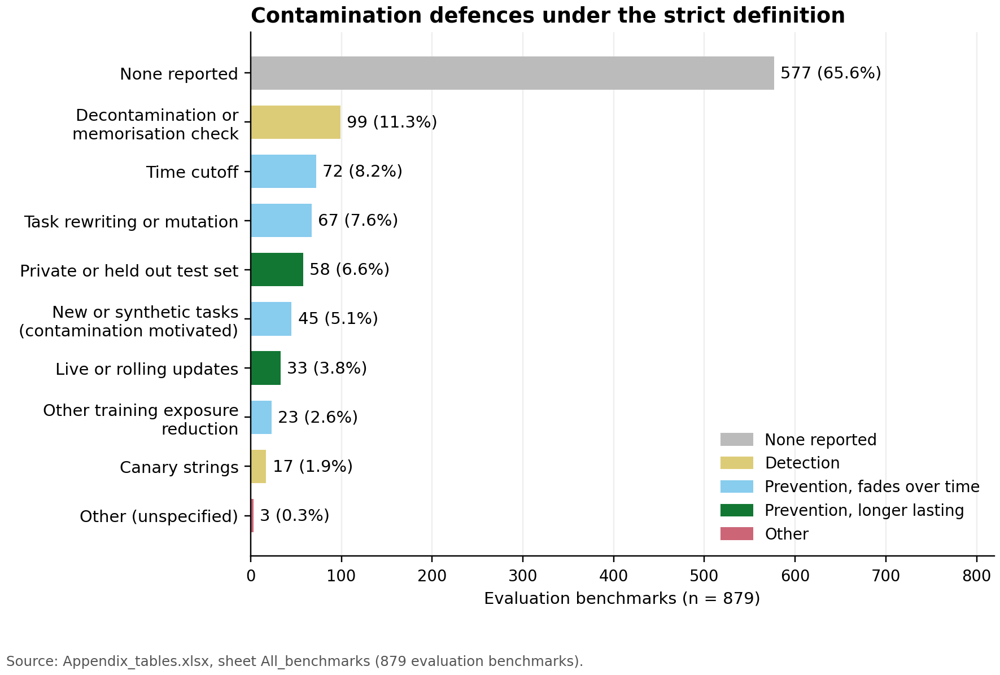
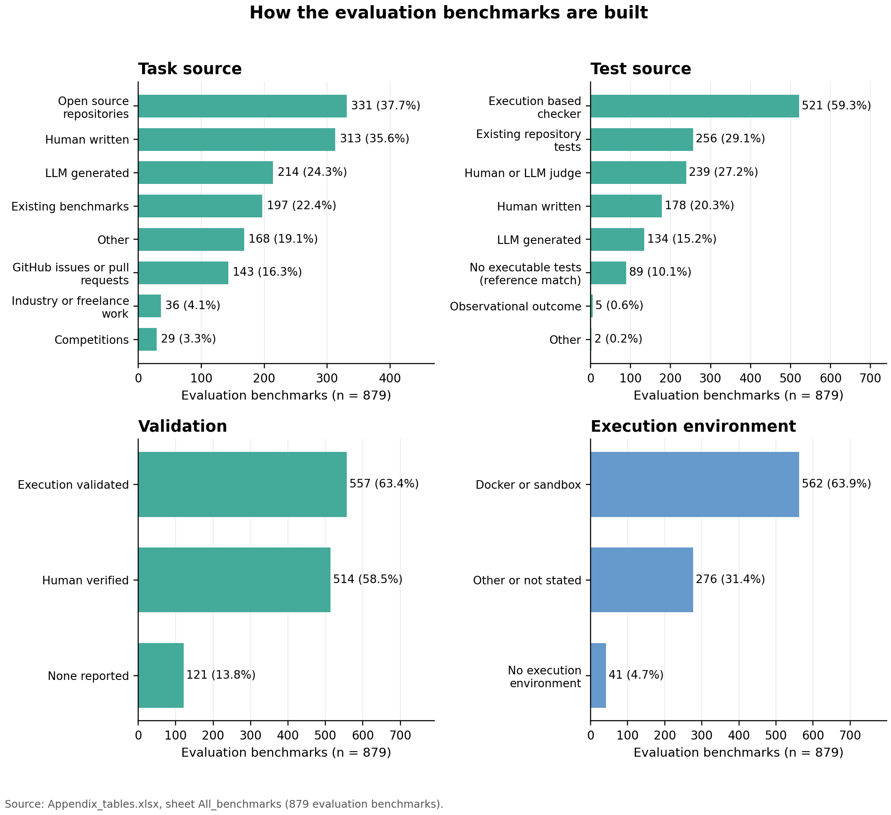
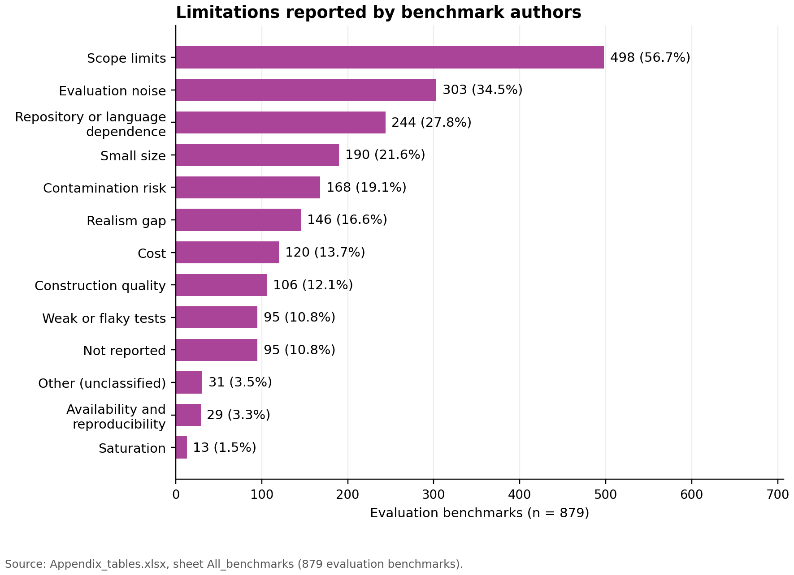
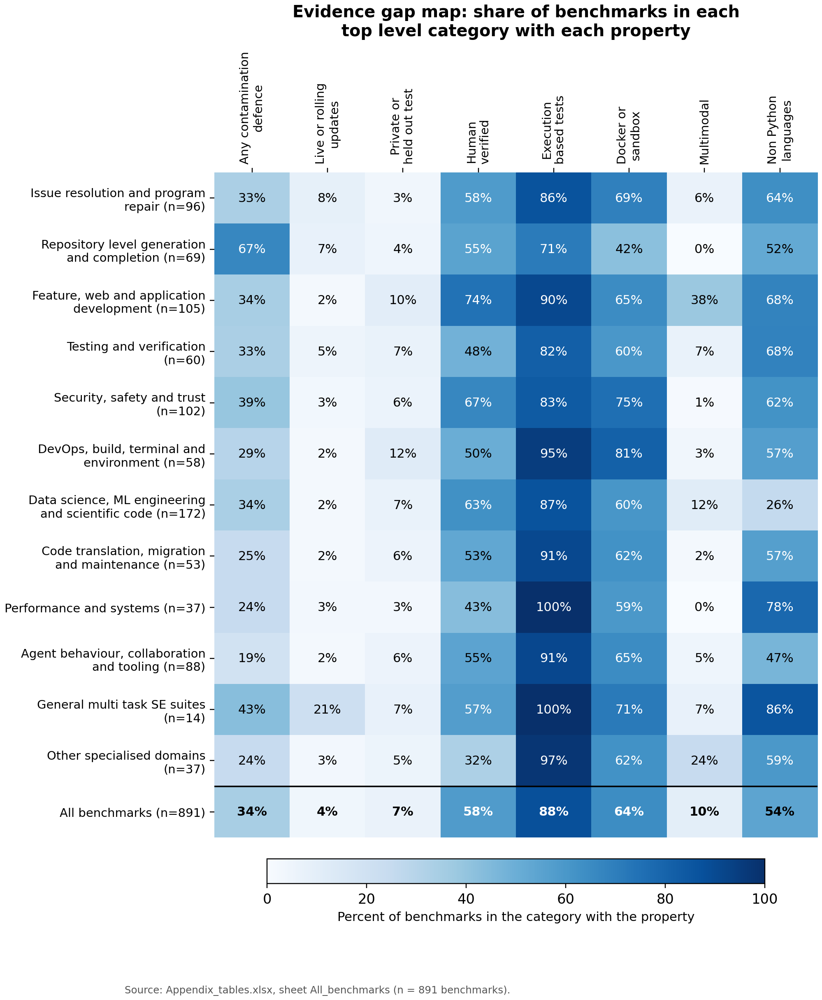

# Benchmarks for Evaluating Coding Agents and Agentic Software Engineering Systems

**A PRISMA guided review and taxonomy (November 2022 to November 2026)**

Md Forhadul Islam, prepared for Dr Fazilat Hojaji

This repository holds the report (`Report.pdf`) of my review of the benchmarks and datasets used to evaluate coding agents, with the
workbooks, figures, tables and the Jupyter notebooks that produced them.

## At a glance

| | |
|---|---|
| Records identified | 28,426 (databases and five rounds of snowballing) |
| Reports assessed on full text | 1,454 |
| Reports included | 1,010 |
| Unique benchmarks | 891 (879 evaluation benchmarks, 12 training resources) |
| Taxonomy | 12 top level and 45 sub categories |
| Blind screening check | 37 of 40 records, 92.5 percent agreement, Cohen's kappa 0.83 |

## The five research questions

1. Which software engineering benchmarks and datasets are used to evaluate coding agents and agentic engineering systems?
2. Which task categories are represented?
3. How do they address contamination, that is, test data seen during training?
4. How are tasks, datasets and tests constructed?
5. What limitations and challenges are reported, such as repository dependence, realism and training data contamination?

## Main findings

* **Mentions are very concentrated.** SWE-bench is named in 801 of the 1,487 full texts searched, SWE-bench Verified in 283, Terminal-Bench in 208 and
  SWE-Bench Pro in 138. In contrast, 369 of the 879 evaluation benchmarks are not named by any other paper. The SWE-bench family is the largest lineage, with 123 members.
* **Contamination is acknowledged more than it is addressed.** Of the 879 evaluation benchmarks, 577 (65.6 percent) report no
  defence against overlap with training data. Only 89 (10.1 percent) use live updates or private test sets.
* **Benchmarks are mostly built from real code and judged by execution.** Tasks are mined from open source repositories
  (37.7 percent), written by people (35.6 percent) or taken from GitHub issues (16.3 percent). Tasks are also reused from
  earlier benchmarks (22.4 percent) or generated by models (24.3 percent). Success is usually judged by executable checks,
  inside Docker or a sandbox for 63.9 percent.
* **Limits of scope (56.7 percent) and noisy or unstable evaluation (34.5 percent) are the limitations reported most often.**
  They are followed by dependence on a few repositories or on Python (27.8 percent), small size (21.6 percent),
  contamination risk (19.1 percent) and a realism gap (16.6 percent).

### Most mentioned benchmarks

| Rank | Benchmark | Full texts that name it |
|---|---|---|
| 1 | SWE-bench | 801 |
| 2 | SWE-bench Verified | 283 |
| 3 | Terminal-Bench 2.0 | 208 |
| 4 | SWE-Bench Pro | 138 |
| 5 | MLE-bench | 125 |
| 6 | RepoBench | 92 |
| 7 | PaperBench | 88 |
| 8 | MLAgentBench | 85 |
| 9 | SWE-Gym (training resource) | 84 |
| 10 | Multi-SWE-bench | 80 |

The full top 30 is in `Tables/Most_mentioned_benchmarks_top30.xlsx`.

### Task categories and contamination defences

| Top level category | Evaluation benchmarks | With any contamination defence |
|---|---|---|
| Repository level generation and completion | 69 | 46 (66.7%) |
| General multi task SE suites | 14 | 6 (42.9%) |
| Security, safety and trust | 102 | 40 (39.2%) |
| Issue resolution and program repair | 87 | 31 (35.6%) |
| Feature, web and application development | 105 | 36 (34.3%) |
| Data science, ML engineering and scientific code | 170 | 58 (34.1%) |
| Testing and verification | 60 | 20 (33.3%) |
| DevOps, build, terminal and environment | 57 | 17 (29.8%) |
| Code translation, migration and maintenance | 53 | 13 (24.5%) |
| Performance and systems | 37 | 9 (24.3%) |
| Other specialised domains | 37 | 9 (24.3%) |
| Agent behaviour, collaboration and tooling | 88 | 17 (19.3%) |
| **All evaluation benchmarks** | **879** | **302 (34.4%)** |

Counts in this table cover the 879 evaluation benchmarks, as in Table 7 of the report (the 12 training resources are left out). The full
breakdown by defence is in `Tables/Contamination_by_category.xlsx`.

## Figures

**Figure 1. PRISMA 2020 flow diagram**

**Figure 2. Benchmarks introduced per year, coloured by top level task category**

**Figure 3. SWE-bench family lineage**

**Figure 4. Task taxonomy**

**Figure 5. Granularity of the evaluation benchmarks**

**Figure 6. Contamination defences of the evaluation benchmarks**

**Figure 7. How the evaluation benchmarks are built**

**Figure 8. Limitations reported by benchmark authors**

**Figure 9. Evidence gap map**

## How the review was done

The notebooks follow the steps in the order they were done. Each notebook shows its code, the scripts it runs and their saved
outputs, and GitHub displays them directly.

| Step | Notebook | What it does |
|---|---|---|
| 1 | `Notebooks/Step_1_Search.ipynb` | Database searches (OpenAlex and Google Scholar) and the first round of forward snowballing from the seed benchmarks |
| 2 | `Notebooks/Step_2_Duplicates_and_tracker.ipynb` | Removal of duplicates and the master tracker |
| 3 | `Notebooks/Step_3_Title_and_abstract_screening.ipynb` | Title and abstract screening against the eligibility criteria |
| 4 | `Notebooks/Step_4_Snowballing.ipynb` | Backward snowballing from the screened papers, then rounds 2 to 5, each screened on title and abstract, until a round found no new included paper |
| 5 | `Notebooks/Step_5_Analysis_tables_and_figures.ipynb` | Every table and figure, made last and only from the three Excel workbooks in this folder |

`Notebooks/setup.py` holds the helpers that Steps 1 to 4 import. Rerunning Steps 1 to 4 needs the full project folder with the
saved search exports, decisions and papers, which I can share on request. Step 5 needs only the three Excel workbooks in this
folder, so it can be rerun from this repository alone.

## Files

| File or folder | Contents |
|---|---|
| `Report.pdf` | The report |
| `Appendix_tables.xlsx` | Every benchmark with its coded facets, the taxonomy sub categories and the earlier surveys |
| `Included_papers_review.xlsx` | Every included paper with its answers to the five questions, and every full text decision |
| `Master_Tracker.xlsx` | Every screened record with its final decisions |
| `Figures/` | The nine figures of the report, made by the Step 5 notebook |
| `Tables/` | The five tables, made by the Step 5 notebook |
| `Notebooks/` | The five step notebooks and `setup.py` |

## Use of AI

Claude (by Anthropic) was used as a tool under my direction, to help write the scripts and to apply my eligibility rules and
extraction form. I read every included paper and checked it against its full text. Section 4.11 of the report gives the details.
